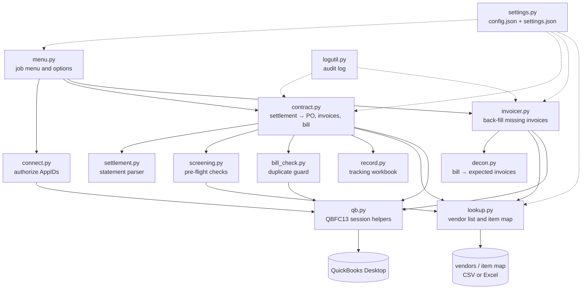

# qb-opsbot

**A desktop bot that turns refinery settlement spreadsheets into QuickBooks Desktop purchase orders, bills and intercompany invoices, and back-fills any invoices that were missed, through Intuit's QBFC SDK.**

## Background

Built in 2019–2020 to automate bookkeeping at a multi-location metals recycling company. Material such as catalytic converters and scrap metal was bought at one location, sent to a refiner, and later settled on a spreadsheet statement: assay results for platinum, palladium and rhodium, per-piece items, treatment charges, advance payments, interest and wire fees. Every statement had to be keyed into QuickBooks by hand as a purchase order, a bill, and one or two internal invoices allocating the material to the right site. The work was slow and repetitive, and keying the same statement in twice was easy to do.

qb-opsbot does the whole entry in one pass. It validates the statement first, refuses to enter anything it has already entered, and logs every action. It was one piece of a broader automation suite Weston built for the company's back office, which together saved roughly $100K–$120K a year in labor.

## Features

- **Settlement → PO + Bill + Invoices.** It parses a settlement workbook and creates, in one QuickBooks session:
  - a **purchase order** to the vendor with every assay lot, per-piece item and fee
  - a **primary-site invoice** and, when needed, a **secondary-site invoice**, with lines routed by item category
  - a **bill** linked to the PO, with a memo that cross-references the invoice numbers
- **Configurable statement layout.** Row labels, columns and offsets for every section live in `config.json`, not in code.
- **Pre-flight screening.** Every item on the statement must map to a QuickBooks item in the target books, and the vendor and item tables must load, before anything is written. Statement vendor names are translated to QuickBooks vendor names through a lookup table.
- **Duplicate protection.** It queries QuickBooks for an existing bill from the same vendor, on the same date, for the same amount (within $0.02), and stops if it finds one.
- **Invoice back-fill.** For a date range it scans open bills, works out which site invoices each bill implies, matches existing invoices (same date, amount within $0.02), creates only the missing ones, and stamps the bill memo so the next run skips it. False negatives are preferred over duplicates.
- **Multi-company aware.** Several QuickBooks company files ("books"), each with its own item mapping, plus server profiles that control which files each machine can open.
- **Item normalization.** Lot-specific names (for example `Sample Weight - Lot 7`) map to one catalog item while the original description is kept on the line.
- **Audit log.** Every run appends a timestamped SUCCESS/FAILED/WARNING block with QuickBooks status codes.
- **Optional tracking workbook.** It can mark each contract as entered in a yearly tracking spreadsheet, with a link to the folder the statement came from.
- **GUI menu** (easygui), packaged as a stand-alone Windows `.exe` with PyInstaller.

## How it works

### Settlement job

1. The user picks one or more settlement workbooks. `settlement.parse_settlement()` reads the configured sheet and builds a `Settlement`: contract number, vendor, payment date, books code, assay lots (`AssayLot` with Pt/Pd/Rh quantities and amounts), not-on-assay items (`NonAssayLot` with pieces × rate), fees, advance payment and final balance. It also computes the true final balance, which is the final balance plus the advance.
2. `screening` loads the vendor list and checks every item against the item map for the statement's books code. Any unmapped item stops the run with a logged error.
3. `bill_check` asks QuickBooks whether a matching bill already exists. If one does, the run stops.
4. `lookup` resolves the vendor's QuickBooks name and each item's full name (`Category:Item`) for those books.
5. `contract` builds the requests and sends them in order through `qb` (a thin QBFC13 session wrapper):
   - **PurchaseOrderAdd**: assay lines (`Assay- Pt 1.23456 oz Contract # C-1001 01/31/2020`), item lines, fee lines
   - **InvoiceAdd** to the primary site: assay lines, items whose category prefix routes to the primary site (plus keyword overrides), and fees
   - **InvoiceAdd** to the secondary site, only if any items route there
   - **BillAdd** linked to the PO (`LinkToTxnIDList`), with memo `Invoiced <primary> #<ref>, Invoiced <secondary> #<ref>`
6. Each response is checked and logged, and `record` updates the tracking workbook if one is configured.

### Invoice back-fill job

1. Pick a company file and a date range.
2. `invoicer` queries bills and invoices in the range. `decon` breaks each bill into the "pseudo-invoices" it should have produced (primary and secondary, by item routing).
3. Bills already stamped in the memo are skipped. The remaining bills are matched against existing invoices by date and amount.
4. Missing invoices are created, and each bill's memo is updated once (`BillMod` with the current `EditSequence`).

### Connect job

This job opens a company file under each of the bot's AppIDs, so an admin can approve the integration in QuickBooks once, ahead of time.

## Architecture



| Module | Responsibility |
|---|---|
| `menu.py` | easygui job menu; Connect (by server profile), Options (debug mode, server location, view log) |
| `settlement.py` | Pure-Python statement model (`Settlement`, `AssayLot`, `NonAssayLot`, `Fees`, `AdvanceFees`) and `parse_settlement(sheet, layout)` |
| `contract.py` | Settlement job: classify and route items, build the PO, invoice and bill requests, handle responses |
| `invoicer.py` | Back-fill job: load bills and invoices, match them, create missing invoices, update memos |
| `decon.py` | Bill, invoice and line models; splits a bill into the primary/secondary invoices it implies |
| `screening.py` | Pre-flight checks (vendor table loads, every item mapped for the books) |
| `bill_check.py` | Duplicate-bill guard (vendor + date + amount ± $0.02) |
| `lookup.py` | Loads the vendor list and item map (CSV, `.xlsx` or `.xls`); item-name normalization; books-code resolution |
| `connect.py` | Shared AppID authorization and host-info query |
| `record.py` | Optional yearly tracking-workbook update |
| `qb.py` | QBFC13 constants, AppIDs, and session/request helpers (lazy `win32com` import) |
| `settings.py` | Loads `config.json` (deep-merged over defaults) and per-machine `settings.json` |
| `logutil.py` | Shared timestamped log-block writer |

## Tech stack

Python 3.8 · pywin32 (COM) · Intuit QuickBooks SDK / QBFC13 (qbXML 7.0) · openpyxl · xlrd · easygui · JSON config · pytest with `unittest.mock` · Poetry · PyInstaller

## Requirements

- Windows (the QuickBooks SDK is COM-based)
- QuickBooks Desktop (US edition), with the bot authorized in each company file
- Intuit QuickBooks SDK 13 (QBFC13)
- Python 3.8
- Poetry

The parser, routing logic and test suite are pure Python and run on any OS. Only the QuickBooks calls need Windows.

## Install

```bat
git clone https://github.com/Weston-Matthews/qb-opsbot.git
cd qb-opsbot
poetry install
copy config.example.json config.json
```

Without Poetry: `pip install -r requirements.txt`

## Run

```bat
poetry run qb-opsbot
```

or `poetry run python -m qb_opsbot`. The menu offers:

- **(QB) Connect to a company file to ask for authorization**
- **(QB) Convert settlement spreadsheet into PO, Bill, and Invoice**
- **(QB) Create Invoices for uninvoiced Bills**
- **Options**: debug mode, which server profile this machine uses, and view the log

Try the parser without QuickBooks, using the fictional sample statement:

```bat
poetry run python samples\parse_statement.py samples\sample_statement.xlsx
```

Run the tests (20 tests; QuickBooks is mocked, and Windows isn't required):

```bat
poetry run pytest
```

## Build (stand-alone .exe)

```bat
build.bat
```

This runs `poetry run pyinstaller -y qb-opsbot.spec`. The output is `dist\qb-opsbot\qb-opsbot.exe`, with `config.example.json` and the sample CSVs bundled. Put a `config.json` next to the exe. All spec paths are relative.

## Configuration

`config.json` is git-ignored, so real vendor names, items and file paths stay out of the repository. Start from `config.example.json`, which uses fictional sites and items.

| Section | What it controls |
|---|---|
| `paths` | `vendor_list`, `item_map`, optional `contract_summary_workbook`, `log_file`. Relative paths resolve against the config file. |
| `books` | Books code → menu label and QuickBooks company file (for example `NORTH` → `\\fileserver\QuickBooks\Site North.qbw`) |
| `book_aliases` | Extra codes that map to the same books |
| `server_profiles` / `default_profile` | Which books the Connect menu offers on each machine |
| `settlement_layout` | Sheet index, label text for each section, and the column and row offsets for the assay, not-on-assay and fees sections |
| `items` | Item-map keys for the assay metals and fees, the line-description prefix, name normalization rules, and which original descriptions to keep |
| `invoicing` | Primary and secondary site labels and customer keys, item-category prefixes for each site, keyword overrides, and the "generated by" memo text |
| `record` | Tracking-workbook columns |

Data files:

- **Vendor list** (`data/vendors.example.csv`): column 1 is the name as it appears on statements, column 2 is the vendor's name in QuickBooks. If a vendor isn't listed, the statement name is used as-is.
- **Item map** (`data/item_map.example.csv`): one row per statement item name, plus one column per books code with the QuickBooks item full name. A blank cell means the item isn't valid in those books, and screening fails. The same table holds the keys for the intercompany customers (`custPrimary`, `custSecondary`), the assay-metal items and the fee items.

Per-machine state (debug flag, server profile) is saved to `settings.json`, which is created with defaults if it's missing.

## Sample output

All names and numbers below are fictional and come from `samples/`.

Parsing `samples/sample_statement.xlsx`:

```
Books Code: NORTH
Contract Number: C-1001
Customer Name: Acme Salvage Co
Payment Date: 01/31/2020

Paid on assay: LC-20-0001
Platinum (Pt) | 1.23456 | $1100.0
Palladium (Pd) | 0.5 | $1000.0
Palladium (Pd) | 0.25 | $500.0
Rhodium  (Rh) | 0.1 | $800.0
Total: $3400.0

Not on assay: LC-20-0002
Widget Core - Large | 10.0 | $25.0 | $250.0
Sample Weight - Lot 7 | 1.0 | $40.0 | $40.0
Oxygen Sensor | 20.0 | $3.0 | $60.0
Copper Scrap | 100.0 | $3.0 | $300.0
TOTAL: $650.0

FEES:
Treatment Charge: $-150.0
Less Advance Payment: $-2000.0
Interest on Advance Payment: $-12.5
Wire Transfer Fee (Advance): $-25.0
Interest on Final Payment: $-3.1
Wire Transfer Fee (Final): $-25.0

Final Balance Due: $1834.40
True Final Balance: $3834.40

Vendor in QuickBooks: Acme Salvage Co.
  Widget Core - Large  ->  Converters:Widget Core L  [primary]
  Sample Weight - Lot 7  ->  Converters:Sample Weight  [primary]
  Oxygen Sensor  ->  Each:Oxygen Sensor  [primary_override]
  Copper Scrap  ->  Metals:Copper Scrap  [secondary]
```

What the settlement job sends to QuickBooks for that statement (captured from the mocked test run):

```
PurchaseOrderAdd  vendor "Acme Salvage Co."  ref C-1001  date 01/31/2020
  Converters:Assay Pt        Assay- Pt 1.23456 oz Contract # C-1001 01/31/2020   qty 1.23456   $1,100.00
  Converters:Assay Pd        Assay- Pd 0.5 oz Contract # C-1001 01/31/2020       qty 0.5       $1,000.00
  Converters:Assay Pd        Assay- Pd 0.25 oz Contract # C-1001 01/31/2020      qty 0.25        $500.00
  Converters:Assay Rh        Assay- Rh 0.1 oz Contract # C-1001 01/31/2020       qty 0.1         $800.00
  Converters:Widget Core L                                                       10 @ $25.00
  Converters:Sample Weight   Sample Weight - Lot 7                               1 @ $40.00
  Each:Oxygen Sensor                                                             20 @ $3.00
  Metals:Copper Scrap                                                            100 @ $3.00
  Assay Fees:Treatment Charge   Assay- Treatment Charge                                         -$150.00
  Assay Fees:Interest Charge    Assay- Interest Charge ADV                                       -$12.50
  Assay Fees:Wire Fee           Assay- Wire Fee ADV                                              -$25.00
  Assay Fees:Interest Charge    Assay- Interest Charge FINAL                                      -$3.10
  Assay Fees:Wire Fee           Assay- Wire Fee FINAL                                            -$25.00

InvoiceAdd  customer "Site North (internal)"   assay lines, Widget Core L, Sample Weight, Oxygen Sensor, fees
InvoiceAdd  customer "Site South (internal)"   "PORTION OF ACME SALVAGE CO - C-1001", Metals:Copper Scrap 100 @ $3.00
BillAdd     vendor "Acme Salvage Co."  ref C-1001  linked to the PO
            memo "Invoiced Site North #1042, Invoiced Site South #1042"
```

Log entry:

```
Contract # C-1001
Timestamp: 2020-01-31 10:42:07.512345
Status: SUCCESS
Action: Added invoice, purchase order, and bill to QuickBooks
------------------------------------
```

## Limitations

- Windows and QuickBooks Desktop only (QBFC13, US edition, qbXML 7.0). QuickBooks Online isn't supported.
- Each statement format needs its own `settlement_layout`. The parser expects the section structure shown in the sample (assay lots, then not-on-assay lots, then fees).
- Item routing works on category prefixes and keywords. Anything more complex needs code changes.
- Duplicate detection is a heuristic (vendor, date and amount ± $0.02).
- Uses a simple easygui interface. There's no headless or scheduled mode.
- Written in 2019–2020 for Python 3.8 and PyInstaller 3.6. It hasn't been updated for newer versions.

## Author

**Weston Matthews** · [github.com/Weston-Matthews](https://github.com/Weston-Matthews)

## License

MIT. See [LICENSE](LICENSE).
